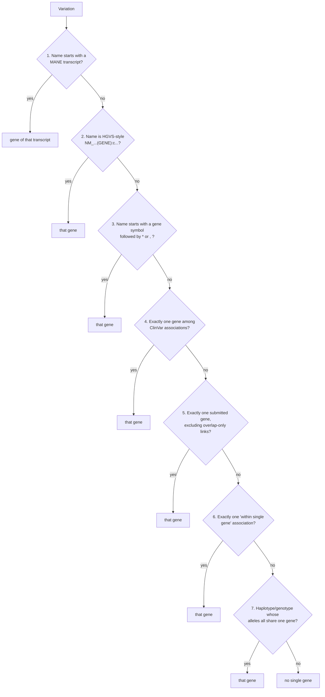

# Single Gene Variation: Method

The `single_gene_variation` table assigns **at most one representative gene** to each ClinVar variation in a release. Downstream work uses it whenever it needs a variant's gene context:

- GenomeConnect observations (`gc_scv_obs`)
- curation tracker reports
- the somatic (cancer gene) flag
- the gene qualifier on ClinVar-GKM propositions

This page explains how the gene is chosen, why each rule exists, and where the method knowingly falls short. It is written for geneticists and bioinformaticians who need to trust, question, or extend the result.

!!! info "What this table is, and is not"
    - **It is a derived interpretation.** ClinVar's own data is never modified. Every rule reads ClinVar's release tables (`variation`, `gene_association`) and a gene reference table, and writes only `single_gene_variation`.
    - **"No single gene" is a valid outcome.** A variant that ClinVar associates with two or more genes, such as a multi-gene deletion, gets no row. The method does not force a choice where none is justified.
    - **One gene, not the gene.** A variant may lie in one gene and still affect another. This table answers "which single gene, if any, is this variant *about*?" It does not say which genes the variant may affect.

## Inputs and output

| Input | Source | Role |
|---|---|---|
| `{release}.variation` | ClinVar release | Variation name (title), subclass (SimpleAllele, Haplotype, Genotype) and component alleles |
| `{release}.gene_association` | ClinVar release | ClinVar's variant-to-gene links, each with a `relationship_type` and a `source` (`submitted` or `calculated`) |
| `{release}.gene` | ClinVar release | The NCBI genes ClinVar uses in this release, with the HGNC symbol and HGNC id **as they were at the time**. This is the main gene reference (see [Which genes the method can see](#which-genes-the-method-can-see)). |
| `clinvar_ingest.ncbi_gene_history` | NCBI Gene, add-only (see [Reference data](#reference-data)) | When NCBI discontinued each gene id. Used to drop ids that were already discontinued when the release was published. |
| `clinvar_ingest.entrez_gene` | NCBI Gene, add-only (see [Reference data](#reference-data)) | Fallback for genes the release's gene table does not list, e.g. a gene named in a variant title that ClinVar does not associate |
| `clinvar_ingest.mane_transcript` | NCBI MANE, add-only (see [Reference data](#reference-data)) | Every MANE release's MANE Select and MANE Plus Clinical transcripts (accession.version → gene), with its release date. Rule 1 uses the release that was current on the ClinVar release date. |
| `clinvar_ingest.cancer_genes` | Curated list | Sets the `somatic` flag |

Output: `{release}.single_gene_variation`, one row per variation that gets a gene.

| Column | Meaning |
|---|---|
| `variation_id` | ClinVar variation id. Unique in the table. |
| `gene_id` | NCBI Gene id of the assigned gene. |
| `relationship_type` | ClinVar's relationship for the chosen association, e.g. `within single gene`. Rules 4 and 5 can produce a comma-separated list when the gene has several associations. Note that the ClinVar value `asserted, but not computed` itself contains a comma. Three values are produced by this method, not by ClinVar: `named gene not associated` (the gene came from the variant's name, and ClinVar has no association to it), `association not provided by clinvar` (haplotype or genotype rule), and the source `cvc calculated`. |
| `source` | ClinVar's `submitted` / `calculated`, or `cvc calculated` when the method inferred the gene. |
| `mane_select` | `TRUE` when the gene came from rule 1: the variant name uses a MANE transcript (MANE Select or MANE Plus Clinical) of the MANE release current at the time. |
| `somatic` | `TRUE` when the gene's HGNC id is in `clinvar_ingest.cancer_genes`. |

## The rules, in order

Rules are applied in order. **The first rule to assign a gene wins**, and each later rule only looks at variations that still have no gene. Earlier rules use stronger evidence: what the submitter or ClinVar named the variant by comes before computed overlaps.

| # | Rule | Evidence used | Example |
|---|---|---|---|
| 1 | **MANE transcript in the name.** The variation name starts with a MANE Select or MANE Plus Clinical transcript accession, **including its version**, from the MANE release that was current on the ClinVar release date. | Variant name + MANE | `NM_000527.5(LDLR):c.…` where NM_000527.5 is LDLR's MANE Select transcript → LDLR, `mane_select = TRUE` |
| 2 | **Gene symbol in an HGVS-style name.** The name matches `NM_/NR_/…(SYMBOL):…`, and SYMBOL is an HGNC symbol in the release's gene reference (see [Which genes the method can see](#which-genes-the-method-can-see)). A named companion gene is skipped when the variant has exactly one main gene. | Variant name | `NR_189288.1(RNVU1-27):n.100C>G` → RNVU1-27 |
| 3 | **Gene-prefixed name**, such as a star allele. The name starts with a symbol followed by `*` or `,`. | Variant name | `CYP2C19*10` → CYP2C19 |
| 4 | **One gene in ClinVar's associations.** All of the variation's gene associations point to the same gene. | `gene_association` | |
| 5 | **One submitted gene.** Considers only associations with `source = 'submitted'`, ignoring the relationships `genes overlapped by variant` and `asserted, but not computed`, which say little about which gene the variant is about. | `gene_association` | |
| 6 | **One `within single gene` association.** | `gene_association` | |
| 7 | **Haplotype or genotype.** All component SimpleAlleles that have a gene association share one gene. | Component alleles' `gene_association` | Variation 3737 ("FH Aarhus"), a haplotype of two alleles both in LDLR → LDLR |

Finally, `somatic` is set for every row whose gene is a cancer gene.

!!! note "Rule 1: a MANE name wins, even for a companion gene"
    - A different version of the same accession does not match. In the 2026-10-11 release, 6,799 variants are named with the MANE accession but another version, e.g. `NM_000527.4`. They get their gene from rule 2 instead, with `mane_select = FALSE`.
    - Using the MANE release current at the time keeps this in step with ClinVar's own naming. Switching 2026-10-11 from MANE v1.0 to v1.5 set `mane_select` on 17,871 more variants, and removed it from 554 named with transcript versions MANE has since replaced.
    - Rule 1 runs before the companion rule (below). MANE v1.5 includes MANE transcripts for some non-coding companion genes. So a variant named on one, e.g. `NR_003529.4(CDKN2B-AS1):n.371+1G>C`, gets that gene (CDKN2B-AS1), even though ClinVar also associates it with a main gene (CDKN2A). The variant's own name, on a MANE transcript, is taken as the strongest evidence.

!!! note "Rule 7 reads associations directly"
    Rules 4–6 see only the filtered set of genes described in the next section. Rule 7 reads ClinVar's `gene_association` for the component alleles directly, without those filters. Alleles with no gene association are ignored: a haplotype of one LDLR allele and one allele with no association still gets LDLR.

## Which genes the method can see

ClinVar associates variants with many kinds of NCBI Gene record, not all of which are genes in the clinical sense. Two filters decide which genes count:

- **Filter 1**, the gene reference, applies to rules 1–6.
- **Filter 2**, companion genes, applies to rules 2 and 4–6.
- **Rule 7** reads associations directly (see the note above).

### 1. The gene must have an HGNC-approved symbol when the release was published

The gene reference is rebuilt for every release, so a release only sees the genes, and the symbols, that were current when it came out:

1. **The release's own `gene` table.** ClinVar records, for every gene it uses, the HGNC symbol and HGNC id in effect that week. Genes with no HGNC id at the time (unnamed `LOC…` genes) are left out. A gene HGNC named later, e.g. LOC730100, now NRXN1-DT, is invisible in releases from before it was named.
2. **Minus gene ids NCBI had already discontinued by the release date** (`ncbi_gene_history`). ClinVar's gene table keeps some discontinued ids, still carrying an HGNC id: 83 in the 2023-01-07 release and 31 in 2026-10-11. For example, CRIPAK (285464) was discontinued in 2019 but is still listed, and it lies inside UVSSA. Counting it would cost about 180 UVSSA variants their gene.
3. **Plus `entrez_gene` for genes the release does not list at all.** The release's gene table only holds genes ClinVar associates with some variant. A variant can be named after a gene ClinVar does not associate, e.g. `NR_164162.1(GLRA4):n.1091C>T`, and the name-matching rules still need to find it. Only rules 1–3 can use these genes, because rules 4–6 work from ClinVar's associations.

A ClinVar association to any other record is invisible to rules 1–6. The main excluded groups, as of the 2026-10-11 release:

| Excluded | Why | Scale |
|---|---|---|
| NCBI `biological-region` records, e.g. STARR-seq/MPRA regulatory regions, enhancers, CRISPRi elements | Functional annotations of genomic regions, not genes | ~62,800 gene ids |
| `LOC…` genes and readthroughs without an HGNC symbol | No approved nomenclature | ~1,500 gene ids |

Without this filter, a variant in BRCA1 that also overlaps a catalogued enhancer would have "two genes" and would never get BRCA1.

### 2. Companion genes give way to a single main gene

Many genes are non-coding transcripts **named after, and lying beside, a protein-coding gene**. When ClinVar computes overlaps, a variant in the main gene is often also associated with its companion. Counting both would hide the obvious answer. So:

> A companion gene is ignored **only when the variant has exactly one main gene** — a visible gene that is not a companion. Otherwise it is treated like any other gene.

Companions are recognised by HGNC naming conventions, using the symbol in effect for the release. Readthroughs are recognised from the gene's full name:

| Family | HGNC convention | Example | Human genes (Oct 2026) |
|---|---|---|---|
| Divergent transcript | `GENE-DT` | NRXN1-DT, ANKRD11-DT | ~760 |
| Long intergenic non-coding RNA | `LINC#####` | LINC03113 | ~2,500 |
| microRNA host gene | `MIR###HG` | MIR4733HG, MIR3936HG | ~80 |
| Overlapping transcript | `GENE-OT#` | BRCA1-OT1, SIX3-OT1 | ~30 |
| Intronic transcript | `GENE-IT#` | FTO-IT1, CAMTA1-IT1 | ~140 |
| Antisense RNA | `GENE-AS#`, or `GENE-AS` without a number; also older names without the hyphen (`…AS#`) when the full name says "antisense" | BRCA1-AS1, KCNQ1-AS1, HTT-AS, ZFAS1, CCR5AS | ~2,960 |
| Readthrough | `GENE1-GENE2`, where the gene's full name says "readthrough" | INS-IGF2, SPICE1-CFAP44 | ~150 |

Why "exactly one main gene":

- **NRXN1 + NRXN1-DT** (variation 146354). ClinVar lists both. One main gene, NRXN1, so NRXN1-DT gives way → **NRXN1**.
- **INS + IGF2 + the readthrough INS-IGF2.** Ignoring the readthrough would leave two main genes, which is not a single-gene answer. The readthrough is not ignored, and the variant is handled exactly as it was before companions were introduced.
- **A variant whose only gene is a companion**, e.g. in MIR550A3HG, CDKN2A-AS1 or a LINC gene, keeps that gene. There is no main gene to give way to.
- **A variant whose only genes are two or more companions gets no single gene.** For example, the 18q22.1 duplication `GRCh38/hg38 18q22.1(chr18:67600914-67981221)x3` (variation 152550) spans LINC01903 and DSEL-AS1. Neither gives way, because there is no main gene to give way to.
- **A non-coding gene that follows no companion convention counts as a main gene.** Four 6p25.3 copy-number variants show this, e.g. variation 146147, `GRCh38/hg38 6p25.3(chr6:163083-293493)x3`. ClinVar associates each with DUSP22 (protein-coding), LINC03066 (a companion) and LIRIL2R (a long non-coding RNA).
  - LIRIL2R is a second main gene, so nothing gives way, and the variants get **no single gene**.
  - This is the intended outcome: the variant spans several genes, so no one gene represents it.
  - Earlier versions of the method used a gene reference that lacked LINC03066 and LIRIL2R, so these variants were wrongly reduced to DUSP22.
  - A 37 kb duplication over FLG and the newly named CCDST (variation 974718) is handled the same way.

!!! question "Why naming conventions and not NCBI gene type?"
    A rule like "ignore non-coding genes when a protein-coding gene is present" would also catch these companions. It resolves about 18,000 more variants to a single gene in the 2026-10-11 release. But "non-coding" is not the same as "companion". It would also demote **stand-alone non-coding disease genes** whenever ClinVar also lists a protein-coding neighbour. Measured on the 2026-10-11 release, it would move existing assignments away from:

    | Gene | Disease relevance | Assignments that would move |
    |---|---|---|
    | H19 | Imprinting disorders (Beckwith-Wiedemann / Silver-Russell) | 91 of 93 |
    | MIR204 | Inherited retinal dystrophy | 17 |
    | KCNQ1OT1 | Imprinting (11p15) | 7 |
    | SNHG14 | Prader-Willi / Angelman region | 7 |
    | RMRP | Cartilage-hair hypoplasia | 3 |

    HGNC naming conventions encode the relationship that matters, "named after the neighbouring gene", so they are used instead. The gene's full name is used in only two cases:

    - **Readthroughs.** Their symbols have no single pattern, and gene type does not help: most readthroughs are typed `protein-coding`.
    - **Older antisense names without a hyphen.** A symbol ending in `AS` counts only when the full name says "antisense", so that HRAS and KRAS do not.

## Shared symbols and replaced gene ids

NCBI sometimes **replaces a gene id**: the old id is discontinued and a new id takes over the same symbol and HGNC id. For example, RNVU1-27 moved from 115409988 to 124904621. Discontinued ids are dropped from a release's gene reference once their discontinue date has passed, which removes most overlaps. Two ids can still share a symbol, for example when one comes from the release's gene table and the other from the `entrez_gene` fallback.

This matters only for rules 2 and 3, which match on symbol. When a name's symbol matches two ids, the method keeps one:

1. the gene id that **ClinVar associates with this variant in this release**, then
2. the newest (highest) gene id.

Because ClinVar's own association wins, each release gets the id ClinVar used at the time. Variation 3362390, `NR_189288.1(RNVU1-27):n.100C>G`, resolves to 124904621 in the 2026-10-11 release because that is the id ClinVar associates.

## Reference data

| Table | Source | Contents | Role |
|---|---|---|---|
| `{release}.gene` | ClinVar release | Genes ClinVar uses in the release: `id`, `symbol`, `hgnc_id`, `full_name` | Main gene reference, as of the release |
| `clinvar_ingest.ncbi_gene_history` | NCBI [`gene_history.gz`](https://ftp.ncbi.nih.gov/gene/DATA/), human rows | `discontinued_gene_id`, `replaced_by_gene_id`, `discontinued_symbol`, `discontinue_date` | Drops ids already discontinued by the release date |
| `clinvar_ingest.entrez_gene` | NCBI [`Homo_sapiens.gene_info.gz`](https://ftp.ncbi.nih.gov/gene/DATA/GENE_INFO/Mammalia/), genes with an HGNC symbol and HGNC id | `gene_id`, `symbol_from_authority` (HGNC symbol), `symbol` (NCBI symbol), `hgnc_id`, `type_of_gene`, `description` | Fallback for genes the release does not list; also used by the tracker reports |
| `clinvar_ingest.mane_transcript` | NCBI [MANE releases](https://ftp.ncbi.nlm.nih.gov/refseq/MANE/MANE_human/) (`MANE.GRCh38.vX.summary.txt.gz`, v0.91 onward) | `mane_version`, `mane_release_date`, `gene_id`, `hgnc_id`, `symbol`, `transcript_id` (RefSeq accession.version), `mane_status` | Rule 1, using the release current on the ClinVar release date |

**MANE release dates.** NCBI does not publish release dates directly, so each release's date is the earlier of two dates: its directory's and its summary file's. Most release directories were copied in bulk long after their release, and v1.5's summary file was regenerated after it. The resulting dates are 1.0 → 2022-01-31, 1.1 → 2023-04-20, 1.2 → 2023-06-21, 1.3 → 2023-10-25, 1.4 → 2024-10-08 and 1.5 → 2025-09-30. Releases 0.5–0.9 (2018–2020) use an older format and are not loaded; they predate every ClinVar release processed here. The hand-made `clinvar_ingest.mane_select_gene_transcript` table, which this replaces, held MANE v1.0 and is no longer used.

### Keeping the reference current

The stored procedure `clinvar_ingest.gene_reference_update` (`scripts/general/gene-reference-update-proc.sql`) applies the add-only changes. Its caller first downloads the NCBI files and loads them into three staging tables:

- `entrez_gene_stage`: human rows of `gene_info`
- `ncbi_gene_history_stage`: human rows of `gene_history`
- `mane_transcript_stage`: every MANE release's summary file

The procedure:

- refuses a download that looks incomplete: fewer than 90% of the current HGNC-named genes, fewer gene-history rows than are already loaded, or fewer MANE releases than are already loaded
- adds a MANE release whole the first time it appears, and never changes it afterwards
- logs every applied run, even one with nothing new, to `clinvar_ingest.gene_reference_refresh_log`

It has two callers:

- **The clinvar-ingest stored-procedures job**, at the start of every run, before `dataset_preparation`.
- **`scripts/general/update-gene-reference.sh`**, for manual runs. It only reports by default, and applies changes only with `--apply`, after backing up `entrez_gene`.

!!! danger "Validation stops a release without a current refresh"
    `validate_dataset` fails a release if no refresh is logged **on or after the release date**. The error names the last refresh and how to run one. Run `update-gene-reference.sh --apply`, then re-run the release.

`entrez_gene` was built once in September 2024 and refreshed in October 2026, adding 2,230 genes.

!!! warning "Add-only, on purpose"
    The update **never changes or removes** an existing row. It:

    - adds new gene ids to `entrez_gene`, and fills in its `type_of_gene` / `description` where they are empty
    - adds newly discontinued ids to `ncbi_gene_history`; NCBI itself only ever appends to `gene_history`
    - adds each new MANE release to `mane_transcript` whole

    If a symbol were overwritten or a retired id deleted, re-processing an older release could silently give a different answer than it did originally. The cost of add-only is that a renamed gene keeps its old symbol in `entrez_gene`. That only matters for the fallback, because each release's symbols come from its own gene table.

## Reproducibility over time

The table is rebuilt from scratch whenever the procedure runs for a release. Because the gene reference comes from the release itself, filtered by NCBI's discontinue dates, re-running an old release reproduces the gene knowledge of its time:

- it sees only genes HGNC had named by then, under the symbols then in use
- it ignores gene ids NCBI had already discontinued
- it still counts gene ids that were valid then, even if NCBI discontinued them later

Remaining sources of drift, all small:

- **The `entrez_gene` fallback** reflects today's knowledge. It only affects name matching for genes the release does not list, and a release's variant names can only contain symbols that existed at the time.
- **`cancer_genes` is today's list.** Re-running an old release uses the current cancer genes for the `somatic` flag. MANE, by contrast, is matched against the release current at the time (see rule 1).
- **ClinVar's gene table is taken as published.** Errors in it, apart from discontinued ids, carry through.

## Known limitations

- **Some names in a companion family belong to genes of another type.**
  - Three protein-coding genes have `-AS#` names (e.g. SFTA2-AS1) and are treated as companions.
  - LINC00672 is typed protein-coding but is treated as a companion.
- **microRNA host genes include a disease gene.**
  - MIR17HG causes Feingold syndrome 2.
  - When it is a variant's only gene it is kept. When the variant also has exactly one main gene, MIR17HG gives way to that gene.
- **Rule 6 counts association rows.** A variant whose only `within single gene` gene ClinVar reports twice, once `submitted` and once `calculated`, gets no gene from rule 6. No such variant exists in the 2026-10-11 release.
- **Rule 3 does not apply the companion rule.** Gene-prefixed names, such as star alleles, are almost always main genes.

## Changing the method

The procedure is `scripts/dataset-preparation/04-single-gene-variation-proc.sql`. Before deploying a change:

1. Copy the release's `variation`, `gene_association` and `gene` tables into a scratch dataset. Test at least one early release (e.g. 2023-01-07) and the latest.
2. Run the changed procedure there under a test name.
3. Compare the result with the release's existing `single_gene_variation`:
   - added rows, removed rows, and changed genes, each grouped by the rule that produced them
   - a check for duplicate `variation_id`s
4. Explain every removed or changed row in the pull request before merging.
5. If the change reads a new reference table or column, run `update-gene-reference.sh --apply` first. BigQuery does not check table or column names in a procedure until it runs.

## Backfilling past releases

A change to the method only affects releases processed after it is deployed. Two routines bring past releases, and the temporal data built from them, up to date:

| Routine | What it does |
|---|---|
| `clinvar_ingest.single_gene_variation_backfill(from_date, to_date, rerun_gc_scv_obs)` | Re-runs `single_gene_variation` for each release dataset in the range. Before the first re-run it keeps the original table as `{release}.single_gene_variation_before_backfill`, created once so a rerun never overwrites it. With `rerun_gc_scv_obs = TRUE` it also re-runs `gc_scv_obs`, which reads `single_gene_variation`, keeping `{release}.gc_scv_obs_before_backfill` the same way. Logs each release's comparison with the originals (added, removed, gene changed, duplicate rows; `gc_scv_obs` rows and observations whose gene changed, or the error) to `clinvar_ingest.single_gene_variation_backfill_log`. Safe to re-run. |
| `clinvar_ingest.single_gene_variation_temporal_rebuild(apply_changes)` | Rebuilds `clinvar_single_gene_variations`, and the gene columns of `clinvar_variations`, directly from the per-release tables. It does not replay the weekly temporal pipeline, because these tables keep one row per variation per unbroken run of releases. `FALSE` only builds side tables (`*_rebuild`, expiring after 7 days) and reports differences. `TRUE` keeps `*_before_backfill` copies, then applies the changes in one transaction. No other temporal table uses `single_gene_variation`. |

Steps, after the new procedures are deployed and a gene reference refresh is logged:

1. **Confirm the rebuild reproduces today's data.** Run `CALL clinvar_ingest.single_gene_variation_temporal_rebuild(FALSE);` before any release is re-run.
    - Every count except `identical` must be 0.
    - In October 2026 this matched all 4,668,446 `clinvar_single_gene_variations` rows and all 4,723,744 `clinvar_variations` rows, in about a minute.
2. **Try one release.** Run `CALL clinvar_ingest.single_gene_variation_backfill(DATE '2023-01-07', DATE '2023-01-07', FALSE);`.
    - The result row should show 488 added, 4 removed, 110 gene changed and 0 duplicate rows.
    - Compare `{release}.single_gene_variation` with `{release}.single_gene_variation_before_backfill` to inspect individual variants.
3. **Re-run the rest in chunks**, e.g. one year per call. A BigQuery script stops after 6 hours, and each release takes one to a few minutes. Re-running a range is safe, so resume from where a call stopped.
4. **Review the log.** For example, `SELECT * FROM clinvar_ingest.single_gene_variation_backfill_log ORDER BY release_date`. Look for duplicate rows (must be 0) and for any release whose removals stand out.
5. **Rebuild the temporal data.** Run `CALL clinvar_ingest.single_gene_variation_temporal_rebuild(FALSE);`, review the differences, then run it with `TRUE`. Do this between weekly releases, not while the pipeline is running.
6. **Rebuild what reads the temporal tables,** e.g. `CALL clinvar_ingest.tracker_report_update();`.

!!! note "Should `gc_scv_obs` be re-run too?"
    `gc_scv_obs` takes each observation's gene from the release's `single_gene_variation`. But only the **latest** release's copy is read, by the GenomeConnect tracker report (`variation_tracker.gc_tracker_report_rebuild`). The weekly pipeline rebuilds it for each new release.

    - **For the latest release only:** after the backfill reaches it, run `CALL clinvar_ingest.gc_scv_obs('<latest release schema>');` and then `CALL variation_tracker.gc_tracker_report_rebuild(NULL);`.
    - **For every release** (`rerun_gc_scv_obs = TRUE`): only worth it if someone compares GenomeConnect observations across releases. It applies today's `gc_scv_obs` logic and reference data to old data, so expect changes beyond the gene.
        - On 2023-01-07 it changed no observation's gene, added 5 rows and altered about 160. Some list columns come out in no fixed order, so the changed-row count varies slightly between runs.
        - A failure on a release is logged in `gc_scv_obs_error`, and that release's table is left as it was.

To undo, copy the `*_before_backfill` tables back over the tables they were taken from.

## Change history

| Change | Issue / PR |
|---|---|
| Rule 7 counts distinct genes instead of association rows, so haplotypes whose alleles share one gene get it | [#38](https://github.com/clingen-data-model/clinvar-ingest-bq-tools/issues/38) / [#40](https://github.com/clingen-data-model/clinvar-ingest-bq-tools/pull/40) |
| `entrez_gene` refreshed add-only. Names that match a symbol shared by two gene ids resolve to one id. | [#39](https://github.com/clingen-data-model/clinvar-ingest-bq-tools/issues/39) |
| Companion genes give way to a single main gene. `entrez_gene` gains `type_of_gene` and `description`. | [#39](https://github.com/clingen-data-model/clinvar-ingest-bq-tools/issues/39) |
| The gene reference comes from each release's own gene table, minus ids NCBI had discontinued by the release date, so every release is processed against the gene knowledge of its time | [#39](https://github.com/clingen-data-model/clinvar-ingest-bq-tools/issues/39) |
| Antisense genes (`-AS#`) are treated as companions instead of always being ignored, so a variant whose only gene is antisense keeps it | [#39](https://github.com/clingen-data-model/clinvar-ingest-bq-tools/issues/39) |
| Rule 1 uses the MANE release current on each ClinVar release date (`mane_transcript`, refreshed weekly), instead of a fixed MANE v1.0 list | [#42](https://github.com/clingen-data-model/clinvar-ingest-bq-tools/pull/42) |
