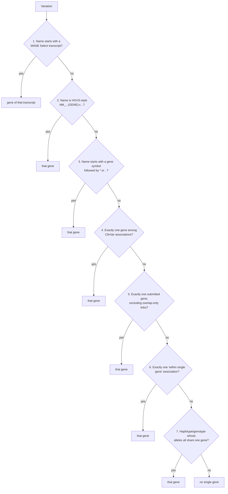

# Single Gene Variation: Method

The `single_gene_variation` table assigns **at most one representative gene** to each ClinVar variation in a release. Downstream work uses it whenever it needs a variant's gene context:

- GenomeConnect observations (`gc_scv_obs`)
- curation tracker reports
- the somatic (cancer gene) flag
- the gene qualifier on ClinVar-GKM propositions

This page explains how the gene is chosen, why each rule exists, and where the method knowingly falls short. It is written for geneticists and bioinformaticians who need to trust, question, or extend the result.

!!! info "What this table is, and is not"
    - **It is a derived interpretation.** ClinVar's own data is never modified. Every rule reads ClinVar's release tables (`variation`, `gene_association`) and a gene reference table, and writes only `single_gene_variation`.
    - **"No single gene" is a valid outcome.** A variant that ClinVar associates with two or more genes, such as a multi-gene deletion, gets no row. The method does not force a choice where none is justified.
    - **One gene, not the gene.** A variant may lie in one gene and still affect another. This table answers "which single gene, if any, is this variant *about*?" It does not say which genes the variant may affect.

## Inputs and output

| Input | Source | Role |
|---|---|---|
| `{release}.variation` | ClinVar release | Variation name (title), subclass (SimpleAllele, Haplotype, Genotype) and component alleles |
| `{release}.gene_association` | ClinVar release | ClinVar's variant-to-gene links, each with a `relationship_type` and a `source` (`submitted` or `calculated`) |
| `clinvar_ingest.entrez_gene` | NCBI Gene, add-only (see [Reference data](#reference-data-entrez_gene)) | The genes the method can see: gene id, HGNC symbol, HGNC id, NCBI gene type and description |
| `clinvar_ingest.mane_select_gene_transcript` | MANE | MANE Select transcript accession → gene |
| `clinvar_ingest.cancer_genes` | Curated list | Sets the `somatic` flag |

Output: `{release}.single_gene_variation`, one row per variation that gets a gene.

| Column | Meaning |
|---|---|
| `variation_id` | ClinVar variation id. Unique in the table. |
| `gene_id` | NCBI Gene id of the assigned gene. |
| `relationship_type` | ClinVar's relationship for the chosen association, e.g. `within single gene`. Rules 4 and 5 can produce a comma-separated list when the gene has several associations. Note that the ClinVar value `asserted, but not computed` itself contains a comma. Three values are produced by this method, not by ClinVar: `named gene not associated` (the gene came from the variant's name, and ClinVar has no association to it), `association not provided by clinvar` (haplotype or genotype rule), and the source `cvc calculated`. |
| `source` | ClinVar's `submitted` / `calculated`, or `cvc calculated` when the method inferred the gene. |
| `mane_select` | `TRUE` when the gene came from a MANE Select transcript in the variant name. |
| `somatic` | `TRUE` when the gene's HGNC id is in `clinvar_ingest.cancer_genes`. |

## The rules, in order

Rules are applied in order. **The first rule to assign a gene wins**, and each later rule only looks at variations that still have no gene. Earlier rules use stronger evidence: what the submitter or ClinVar named the variant by comes before computed overlaps.

| # | Rule | Evidence used | Example |
|---|---|---|---|
| 1 | **MANE Select transcript in the name.** The variation name starts with a MANE Select transcript accession. | Variant name + MANE | `NM_000527.5(LDLR):c.…` where NM_000527.5 is LDLR's MANE Select transcript → LDLR, `mane_select = TRUE` |
| 2 | **Gene symbol in an HGVS-style name.** The name matches `NM_/NR_/…(SYMBOL):…`, and SYMBOL is an HGNC symbol in `entrez_gene`. | Variant name | `NR_189288.1(RNVU1-27):n.100C>G` → RNVU1-27 |
| 3 | **Gene-prefixed name**, such as a star allele. The name starts with a symbol followed by `*` or `,`. | Variant name | `CYP2C19*10` → CYP2C19 |
| 4 | **One gene in ClinVar's associations.** All of the variation's gene associations point to the same gene. | `gene_association` | |
| 5 | **One submitted gene.** Considers only associations with `source = 'submitted'`, ignoring the relationships `genes overlapped by variant` and `asserted, but not computed`, which say little about which gene the variant is about. | `gene_association` | |
| 6 | **One `within single gene` association.** | `gene_association` | |
| 7 | **Haplotype or genotype.** All component SimpleAlleles that have a gene association share one gene. | Component alleles' `gene_association` | Variation 3737 ("FH Aarhus"), a haplotype of two alleles both in LDLR → LDLR |

Finally, `somatic` is set for every row whose gene is a cancer gene.

!!! note "Rule 7 reads associations directly"
    Rules 4–6 see only the filtered set of genes described in the next section. Rule 7 reads ClinVar's `gene_association` for the component alleles directly, without those filters. Alleles with no gene association are ignored: a haplotype of one LDLR allele and one allele with no association still gets LDLR.

## Which genes the method can see

ClinVar associates variants with many kinds of NCBI Gene record, not all of which are genes in the clinical sense. Before rules 2 and 4–6 count genes, three filters apply.

### 1. The gene must be in `entrez_gene`

`entrez_gene` holds human NCBI genes that have an **HGNC-approved symbol and HGNC id** (about 45,000). A ClinVar association to any other record is invisible to rules 1–6. The main excluded groups, as of the 2026-10-11 release:

| Excluded | Why | Scale |
|---|---|---|
| NCBI `biological-region` records, e.g. STARR-seq/MPRA regulatory regions, enhancers, CRISPRi elements | Functional annotations of genomic regions, not genes | ~62,800 gene ids |
| `LOC…` genes and readthroughs without an HGNC symbol | No approved nomenclature | ~1,500 gene ids |

Without this filter, a variant in BRCA1 that also overlaps a catalogued enhancer would have "two genes" and would never get BRCA1.

### 2. Antisense genes (`-AS#`) are always ignored

HGNC names antisense RNA genes after the gene they overlap, with a numbered suffix: `BRCA1-AS1`, `KCNQ1-AS1`… These are ignored in rules 2 and 4–6, whether or not the variant has another gene. This has been the method's behaviour since its first version and is kept unchanged.

### 3. Companion genes give way to a single main gene

Many genes are non-coding transcripts **named after, and lying beside, a protein-coding gene**. When ClinVar computes overlaps, a variant in the main gene is often also associated with its companion. Counting both would hide the obvious answer. So:

> A companion gene is ignored **only when the variant has exactly one main gene** — a gene in `entrez_gene` that is neither `-AS#` nor a companion. Otherwise it is treated like any other gene.

Companions are recognised by HGNC naming conventions, plus NCBI's description for readthroughs:

| Family | HGNC convention | Example | Genes (2026-10-18) |
|---|---|---|---|
| Divergent transcript | `GENE-DT` | NRXN1-DT, ANKRD11-DT | ~760 |
| Long intergenic non-coding RNA | `LINC#####` | LINC03113 | ~2,500 |
| microRNA host gene | `MIR###HG` | MIR4733HG, MIR3936HG | ~80 |
| Overlapping transcript | `GENE-OT#` | BRCA1-OT1, SIX3-OT1 | ~30 |
| Intronic transcript | `GENE-IT#` | FTO-IT1, CAMTA1-IT1 | ~140 |
| Antisense RNA without a number | `GENE-AS` | HTT-AS, DM1-AS, BDNF-AS | ~30 |
| Readthrough | `GENE1-GENE2`, where NCBI's description says "readthrough" | INS-IGF2, SPICE1-CFAP44 | ~150 |

Why "exactly one main gene":

- **NRXN1 + NRXN1-DT** (variation 146354). ClinVar lists both. One main gene, NRXN1, so NRXN1-DT gives way → **NRXN1**.
- **INS + IGF2 + the readthrough INS-IGF2.** Ignoring the readthrough would leave two main genes, which is not a single-gene answer. The readthrough is not ignored, and the variant is handled exactly as it was before companions were introduced.
- **A variant whose only gene is a companion**, e.g. in MIR550A3HG or a LINC gene, keeps that gene. There is no main gene to give way to.
- **A non-coding gene that follows no companion convention counts as a main gene.** Four 6p25.3 copy-number variants show this, e.g. variation 146147, `GRCh38/hg38 6p25.3(chr6:163083-293493)x3`. ClinVar associates each with DUSP22 (protein-coding), LINC03066 (a companion) and LIRIL2R (a long non-coding RNA).
  - LIRIL2R is a second main gene, so nothing gives way, and the variants get **no single gene**.
  - This is the intended outcome: the variant spans several genes, so no one gene represents it.
  - Before the October 2026 refresh, LINC03066 and LIRIL2R were missing from `entrez_gene`, so these variants were wrongly reduced to DUSP22.

!!! question "Why naming conventions and not NCBI gene type?"
    A rule like "ignore non-coding genes when a protein-coding gene is present" would also catch these companions. It resolves about 18,000 more variants to a single gene in the 2026-10-11 release. But "non-coding" is not the same as "companion". It would also demote **stand-alone non-coding disease genes** whenever ClinVar also lists a protein-coding neighbour. Measured on the 2026-10-11 release, it would move existing assignments away from:

    | Gene | Disease relevance | Assignments that would move |
    |---|---|---|
    | H19 | Imprinting disorders (Beckwith-Wiedemann / Silver-Russell) | 91 of 93 |
    | MIR204 | Inherited retinal dystrophy | 17 |
    | KCNQ1OT1 | Imprinting (11p15) | 7 |
    | SNHG14 | Prader-Willi / Angelman region | 7 |
    | RMRP | Cartilage-hair hypoplasia | 3 |

    HGNC naming conventions encode the relationship that matters, "named after the neighbouring gene", so they are used instead. NCBI's description is used only for readthroughs. Their symbols have no single pattern, and gene type does not help: most readthroughs are typed `protein-coding`.

## Shared symbols and replaced gene ids

NCBI sometimes **replaces a gene id**: the old id is retired and a new id takes over the same symbol and HGNC id. For example, RNVU1-27 moved from 115409988 to 124904621. Because `entrez_gene` is add-only, both ids stay, so a few symbols (59 in October 2026) map to two gene ids.

This matters only for rules 2 and 3, which match on symbol. When a name's symbol matches two ids, the method keeps one:

1. the gene id that **ClinVar associates with this variant in this release**, then
2. the newest (highest) gene id.

Because ClinVar's own association wins, a release from before the replacement resolves to the old id, and a later release resolves to the new one. Each release gets the id that was current when it came out. Variation 3362390, `NR_189288.1(RNVU1-27):n.100C>G`, resolves to 124904621 in the 2026-10-11 release because that is the id ClinVar associates.

## Reference data: `entrez_gene`

| | |
|---|---|
| Source | NCBI Gene, [`Homo_sapiens.gene_info.gz`](https://ftp.ncbi.nih.gov/gene/DATA/GENE_INFO/Mammalia/) |
| Rows included | Human genes with an HGNC symbol (`Symbol_from_nomenclature_authority`) and an HGNC id in `dbXrefs` |
| Columns | `gene_id`, `symbol_from_authority` (HGNC symbol), `symbol` (NCBI symbol), `hgnc_id`, `type_of_gene`, `description` |
| Update | `scripts/general/update-entrez-gene.sh`. It reports by default, and applies only with `--apply` after backing up the table. |
| History | Built once in September 2024. Refreshed October 2026, adding 2,230 genes. |

!!! warning "Add-only, on purpose"
    The update **never changes or removes** an existing gene id, symbol or HGNC id. It only adds new gene ids and fills in `type_of_gene` / `description` where they are empty.

    If a symbol were overwritten, re-processing an older release would silently match different names than it did originally. If a retired id were deleted, every older release that references it would lose its gene. The cost of add-only is that a renamed gene keeps its old symbol in this table. That only affects the name-based rules 2 and 3.

## Reproducibility over time

The table is rebuilt from scratch whenever the procedure runs for a release. Its result depends on the release and on the reference tables *as they are on that day*.

- **Stable:** rules driven by ClinVar's own gene ids (4–7, and the tie-break above) cannot pick up a gene that ClinVar did not reference in that release.
- **Can drift:** re-running an old release after `entrez_gene` has grown can make a gene visible that the original run could not see. There are two causes:
    1. **The table was out of date** when the release was first processed. Keeping `entrez_gene` current prevents this. ClinVar can only reference NCBI gene ids that already exist, so a current table would have held them.
    2. **HGNC named the gene later.** ClinVar often references an NCBI gene id while it is still an unnamed `LOC…` gene, and `entrez_gene` only admits a gene once HGNC has named it. Of the genes added in October 2026, 195 are referenced in the 2023-01-07 release. 176 of them had no HGNC symbol at that time, e.g. LOC93622, now MRFAP1L2. Re-running that release applies today's names, which a table that was current in 2023 would not have contained.

    Either way the re-run uses today's gene knowledge. The result is consistent across releases, but it is not a strict point-in-time reconstruction.

[Issue #39](https://github.com/clingen-data-model/clinvar-ingest-bq-tools/issues/39) proposes a dated, add-only gene history. It would let a release be processed against the gene reference as it stood on its release date.

## Known limitations

- **Retired readthrough ids are not recognised as companions.** NCBI no longer describes them, so no description is available.
- **Some names in a companion family belong to genes of another type.**
  - Three protein-coding genes have `-AS#` names (e.g. SFTA2-AS1) and are always ignored.
  - LINC00672 is typed protein-coding but is treated as a companion.
- **microRNA host genes include a disease gene.**
  - MIR17HG causes Feingold syndrome 2.
  - When it is a variant's only gene it is kept. When the variant also has exactly one main gene, MIR17HG gives way to that gene.
- **Rule 6 counts association rows.** A variant whose only `within single gene` gene ClinVar reports twice, once `submitted` and once `calculated`, gets no gene from rule 6. No such variant exists in the 2026-10-11 release.
- **Rule 3 does not apply the antisense or companion filters.** Gene-prefixed names, such as star alleles, are almost always main genes.

## Changing the method

The procedure is `scripts/dataset-preparation/04-single-gene-variation-proc.sql`. Before deploying a change:

1. Copy the release's `variation` and `gene_association` tables into a scratch dataset.
2. Run the changed procedure there under a test name.
3. Compare the result with the release's existing `single_gene_variation`:
   - added rows, removed rows, and changed genes, each grouped by the rule that produced them
   - a check for duplicate `variation_id`s
4. Explain every removed or changed row in the pull request before merging.
5. If the change reads a new column of `entrez_gene`, run `update-entrez-gene.sh --apply` first. BigQuery does not check column names in a procedure until it runs.

## Change history

| Change | Issue / PR |
|---|---|
| Rule 7 counts distinct genes instead of association rows, so haplotypes whose alleles share one gene get it | [#38](https://github.com/clingen-data-model/clinvar-ingest-bq-tools/issues/38) / [#40](https://github.com/clingen-data-model/clinvar-ingest-bq-tools/pull/40) |
| `entrez_gene` refreshed add-only. Names that match a symbol shared by two gene ids resolve to one id. | [#39](https://github.com/clingen-data-model/clinvar-ingest-bq-tools/issues/39) |
| Companion genes give way to a single main gene. `entrez_gene` gains `type_of_gene` and `description`. | [#39](https://github.com/clingen-data-model/clinvar-ingest-bq-tools/issues/39) |
